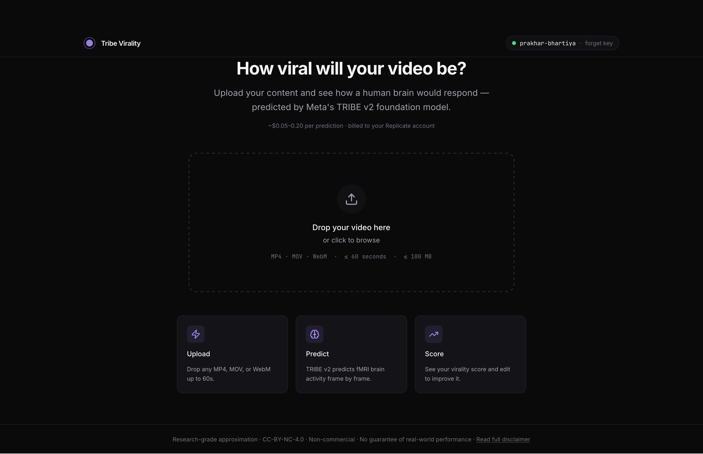
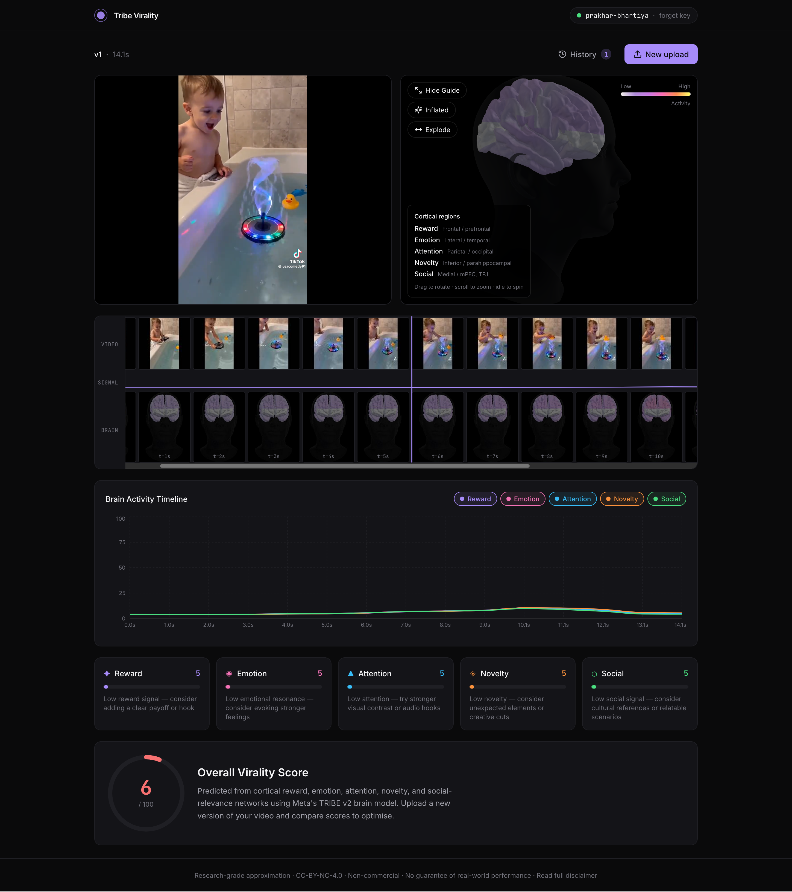
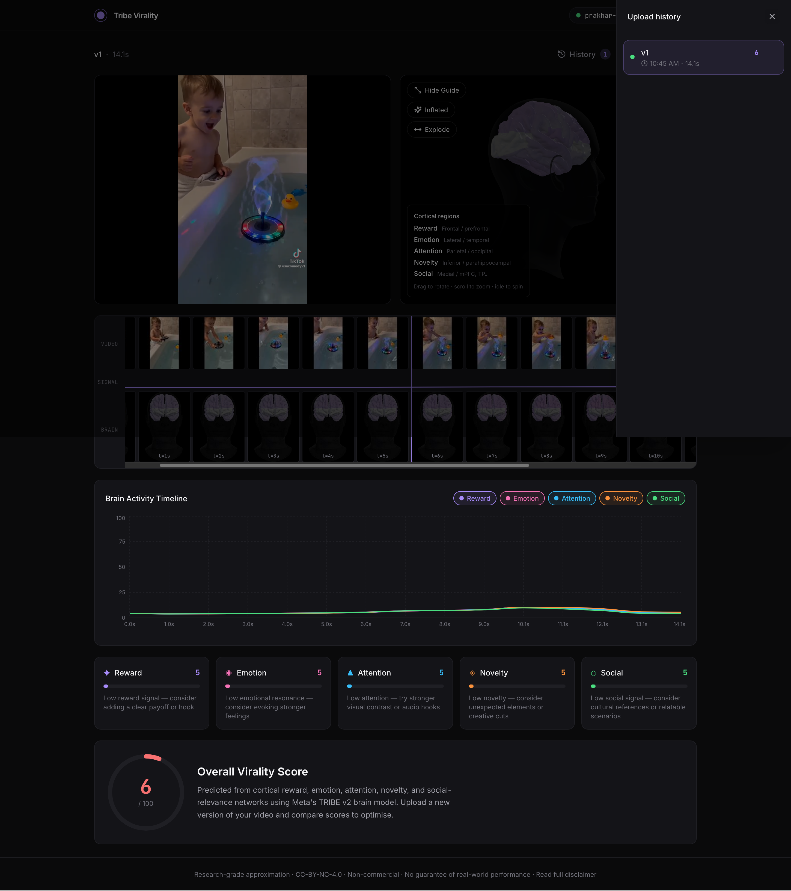

# Tribe Virality

Upload a short video and see how a human brain would respond to it — scored
using Meta's [TRIBE v2](https://huggingface.co/facebook/tribev2), a multimodal
foundation model that predicts fMRI responses to video, audio, and text.
Inference runs on Replicate via the
[`prakhar-bhartiya/meta-tribev2-social-media-content-signal`](https://replicate.com/prakhar-bhartiya/meta-tribev2-social-media-content-signal)
model.

> Research-grade approximation. Non-commercial use only (CC-BY-NC-4.0). Not clinical.

## Screenshots

**1 · Landing** — drop in a short video; you bring your own Replicate token.



**2 · Results** — the predicted brain response, a frame-by-frame activation
timeline, the five cognitive sub-scores, and the overall 0–100 virality score.



**3 · Versioning** — re-upload an edited cut and compare scores across versions
from the upload-history panel.



## Quick start

```bash
cd frontend
npm install
npm run dev
```

Open http://localhost:5173 and paste a Replicate API token when prompted.
You bring your own credits (~$0.05–0.20 per run).

See [`docs/REPLICATE_SETUP.md`](./docs/REPLICATE_SETUP.md) for how to create
the token.

## Stack

Vite + React + TypeScript frontend. Python [cog](https://github.com/replicate/cog)
package for the Replicate model. No application server, no database, no
accounts, no telemetry.

## What we built on top of TRIBE v2

[`cog/`](./cog/) packages TRIBE v2 for Replicate (V-JEPA2 video + Wav2Vec-BERT
audio + Llama-3.2-3B language towers, baked into the image so cold starts
don't pay a multi-GB download), deployed as
[`prakhar-bhartiya/meta-tribev2-social-media-content-signal`](https://replicate.com/prakhar-bhartiya/meta-tribev2-social-media-content-signal). For each video the predictor returns TRIBE's
per-timestep fMRI activation on the fsaverage5 cortical mesh (~20k vertices).

On top of that prediction, [`cog/scoring/`](./cog/scoring/) maps grouped
cortical vertices into five cognitive sub-scores and combines them into a
single 0–100 virality score:

| Sub-score        | Weight | Cortical proxy                                       |
| ---------------- | ------ | ---------------------------------------------------- |
| Reward           | 30%    | Orbitofrontal cortex, ventromedial PFC               |
| Emotion          | 25%    | Anterior insula, anterior cingulate                  |
| Attention        | 20%    | Visual & auditory cortex, intraparietal sulcus       |
| Social Relevance | 15%    | Medial PFC, TPJ, precuneus                           |
| Novelty          | 10%    | Parahippocampal cortex, posterior cingulate          |

Each sub-score is the mean activation in its ROI — taken from the **Destrieux
cortical atlas** — z-scored against an **empirically-calibrated baseline** and
squashed through a sigmoid to 0–100; the emotion/insula term is **sign-flipped**
per the neuroforecasting literature (Genevsky & Knutson, PNAS 2020). The
mapping is deterministic — same file in, same score out. **TRIBE itself does
not produce a "virality score" — this layer is our heuristic.** See
[`cog/METHODOLOGY.md`](./cog/METHODOLOGY.md) for what is grounded, what is not,
and the open limitations, and [`cog/README.md`](./cog/README.md#scoring) for the math.

## Documentation

- [`docs/ARCHITECTURE.md`](./docs/ARCHITECTURE.md) — system design, data flow, project layout
- [`docs/DEPLOYMENT.md`](./docs/DEPLOYMENT.md) — production build + nginx config
- [`docs/REPLICATE_SETUP.md`](./docs/REPLICATE_SETUP.md) — getting a Replicate account & API token
- [`cog/README.md`](./cog/README.md) — building the model & the scoring pipeline
- [`cog/METHODOLOGY.md`](./cog/METHODOLOGY.md) — scoring grounding, limitations & citations
- [`dataset/README.md`](./dataset/README.md) — sample runs & how the baseline corpus is built

## License

CC-BY-NC-4.0 — non-commercial research use only. See [`LICENSE`](./LICENSE).
